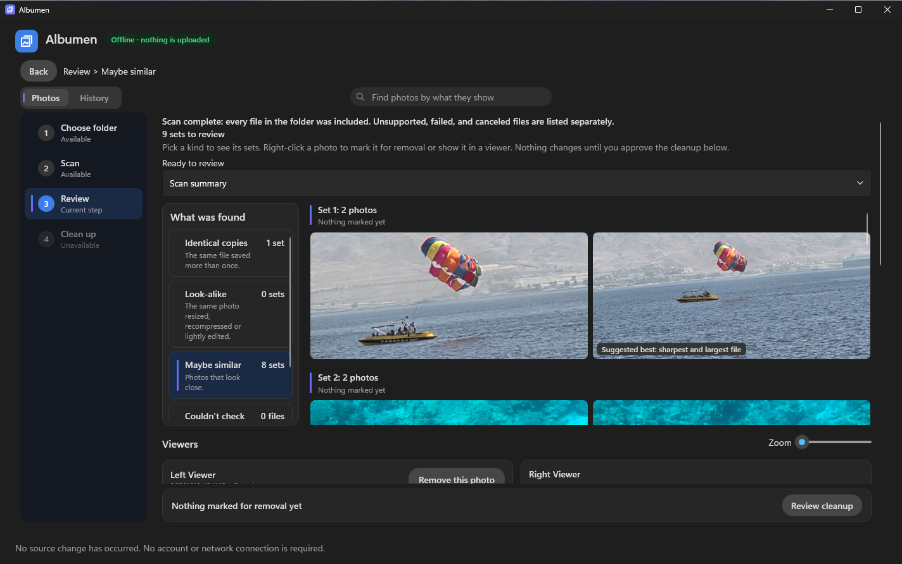
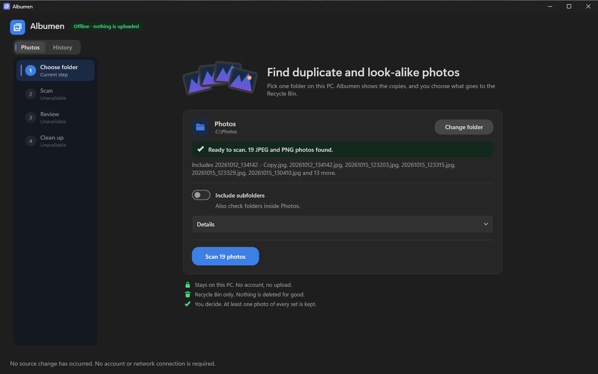
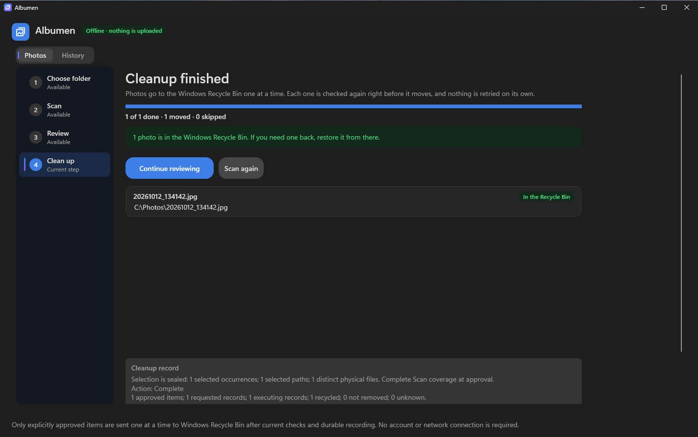
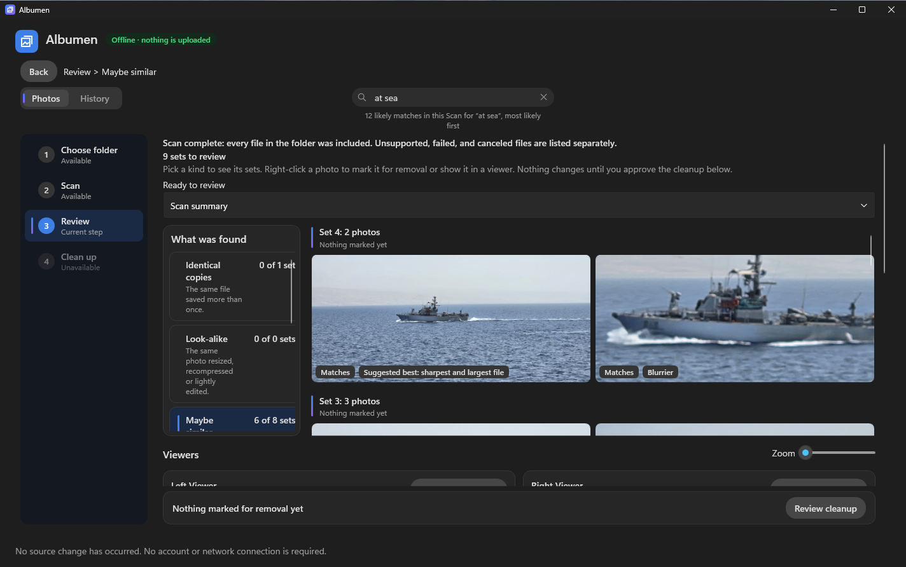
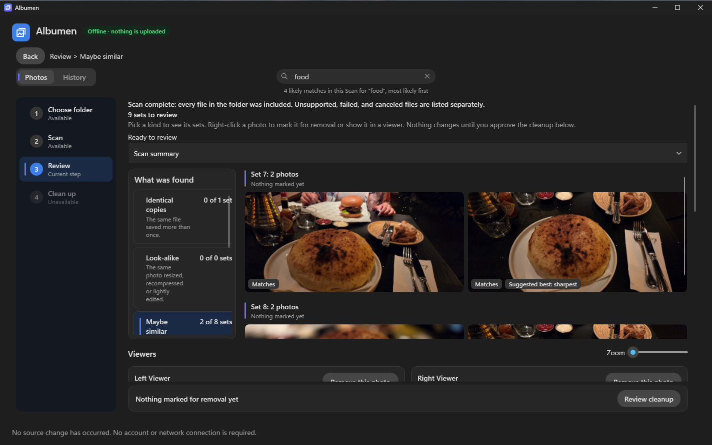
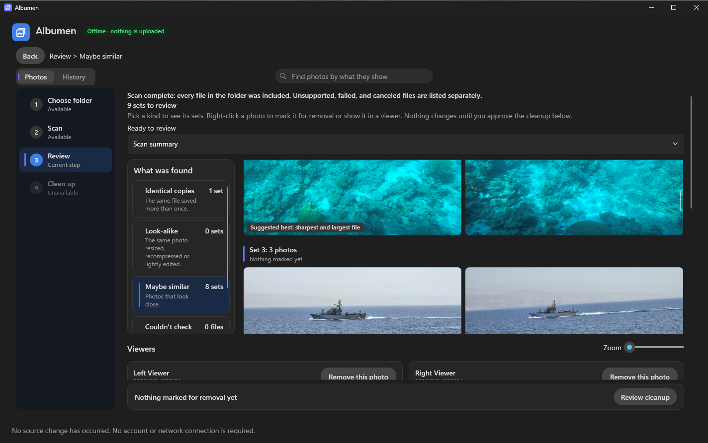
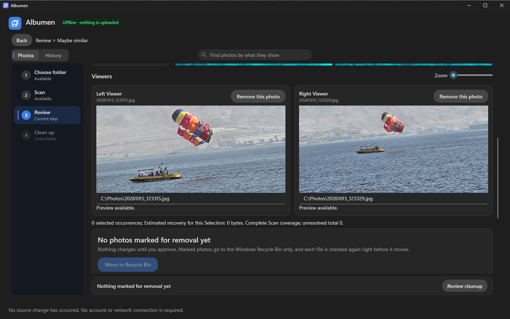
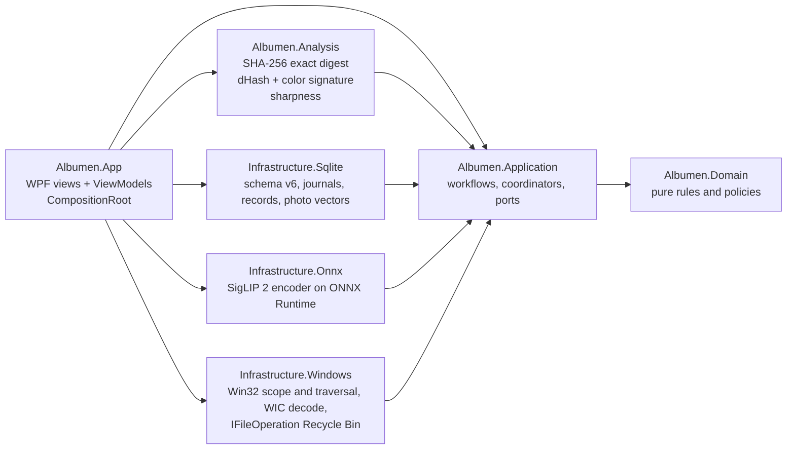

# Albumen

[](https://github.com/IgalFridman-dev/Albumen/actions/workflows/ci.yml)


**Find duplicate and look-alike photos on Windows, search them by what they show, and send only what you approve to the Recycle Bin.**

*Albumen was called PhotoSift until October 2026. It was renamed because another Windows duplicate-photo app already uses that name.*



Albumen is a free, open-source Windows 11 app that finds identical copies and look-alike JPEG and
PNG photos in one folder, shows each set side by side, and moves only the photos you approve to the
Recycle Bin. An on-device image model also groups shots of the same moment and lets you search your
photos by what they show. Everything runs on your PC: no account, no upload, no network at all, and
nothing is ever deleted permanently.

## Download and run

You need Windows 11 x64. Nothing else has to be installed.

1. Download `Albumen-v1.1.5-win-x64.zip` from the
   [latest release](https://github.com/IgalFridman-dev/Albumen/releases/latest) (about 1.1 GB, almost
   all of it the image model) and extract it to a local folder.
2. Run `Start-Albumen.cmd`. It checks every packaged file, then starts the app.
3. The app is not code-signed yet, so Windows SmartScreen may say "Windows protected your PC" the
   first time: choose **More info → Run anyway**. On a PC with Smart App Control turned on, Windows
   blocks the app and offers no way to run it (see [Known limitations](#known-limitations)).

Albumen keeps its own data in `%LOCALAPPDATA%\Albumen`. To remove it, delete that folder and the
extracted app folder; there is no installer.

## How it works for you

| 1. Choose a folder | 2. Approve exactly what goes | 3. See every outcome |
|---|---|---|
|  |  |  |
| Preflight checks the folder is local and readable and names the first photos in it; identical copies and look-alikes are always found. | Nothing moves until you approve. The approval lists every photo and where it goes. | Each photo is sent on its own, and its result is kept in History. |

### Find photos by what they show

An on-device image model (SigLIP 2) reads every photo during the scan. Type a few words in the search
bar at the top of Review and, from 1.1.5, every kind narrows to the sets that hold a matching photo,
best match first, with the matches labelled; matching photos in no set are listed under Other matches.
Nothing leaves the PC, and searching marks nothing for removal and keeps every mark.

| "at sea" | "food" |
|---|---|
|  |  |

| Maybe similar, found by the model | Two viewers side by side |
|---|---|
|  |  |

The same model groups shots of one moment that the pixel hash misses, such as a ship that moved
between frames, as Maybe similar. A classical sharpness measure names the sharpest photo of a set.

## Known limitations

- The app is not code-signed. SmartScreen offers "More info → Run anyway", but on a PC with Smart App
  Control turned on, Windows blocks it and offers no way to run it.
- Accessibility work is not complete, and Albumen makes no accessibility-compliance claim.
- Albumen is dark only. Under Windows High Contrast it uses the system colours.
- Zooming and moving a photo in the Right Viewer can crash the app (a fault in the WPF renderer).
  A fix is planned for 1.2.
- Text search misses small objects in the frame (the model sees each photo at 224 px), and a weak
  match in the search can hide the rest of Review until you clear it.
- The Maybe-similar and blur thresholds are provisional: they have not yet been measured on a
  labelled set of real photos. Always look before you approve.
- Every scan recomputes the photo vectors; nothing is reused across scans yet.
- HEIF support depends on the installed Windows codec and is best effort; JPEG and PNG are supported.

## What's next

- **1.2:** an accessibility pass, the Right Viewer crash fix, and reuse of computed signatures and
  vectors across scans, so a rescan of the same folder is faster.

---

## For developers

The rest of this page is about how Albumen is built. A walkthrough of one run from folder selection
to Recycle Bin, with the classes involved, is in **[docs/HOW-IT-WORKS.md](docs/HOW-IT-WORKS.md)**.

### Why it is interesting

Deleting someone's photos is a one-way door, so Albumen is designed around one question:
*what has to be true before the app is allowed to touch a file?*

- **At least one survivor per group.** The review model refuses any selection that would remove every copy.
- **Sealed approval, fresh revalidation.** Approval produces an immutable request. Right before each
  Recycle Bin call the file is re-checked on disk; if it changed, the action is blocked.
- **Write-ahead journal.** Every action is recorded as `Requested → Executing` in SQLite *before* the
  shell call, and its outcome after. If the app crashes mid-action, the next launch reconciles the
  journal and reports the outcome as unknown. It never replays the action.
- **One item at a time, one owner.** A single serialized Action owner performs every Recycle Bin call,
  so there are no races between UI threads and file operations.
- **Offline by construction.** No network code, no telemetry, no accounts. Verified with network
  audits in an isolated VM that has no network adapter.

### Features

| | |
|---|---|
| **Exact duplicates** | Streaming SHA-256 over file bytes; hard links are recognized as aliases of the same file, not as copies. |
| **Near duplicates** | Managed dHash plus a color signature with conservative thresholds; borderline pairs are left ungrouped. |
| **Maybe similar** | SigLIP 2 photo vectors (ONNX Runtime, on the CPU) join photos whose cosine is high but whose hash differs, such as a burst where the subject moved. These sets are never pre-marked. |
| **Text search** | "Find photos by what they show" ranks the scan's photos against a short prompt by brute-force cosine over the stored vectors: no vector database. It filters Review to the sets with a match; it marks nothing. |
| **Sharpest photo** | A tiled variance-of-Laplacian measure on the decoded photo; "sharpest" is the first reason on a set's suggested best photo. |
| **Guided workflow** | Four steps (Choose folder → Scan → Review → Clean up), each unlocked only when the previous one is valid. The folder and the scan options share one screen. |
| **Safe scope** | Preflight rejects network shares, cloud-only placeholders and protected system folders before scanning. |
| **Review** | Each kind's sets as a virtualized photo gallery with facts on hover, Left and Right viewers with one zoom, Remove by right-click or a viewer button, keyboard navigation and a suggested survivor you can override. |
| **History** | Every cleanup's per-photo outcome survives relaunch and can be checked again read-only later. |
| **Crash-safe scans** | Scan state is checkpointed in SQLite with reconciled accounting; an interrupted scan is closed safely and restarted fresh. |

### Architecture

A hexagonal modular monolith. Domain and Application never reference WPF, SQLite or Win32;
infrastructure adapters implement the ports Application declares, and only the composition root
wires them together. These boundaries are enforced by architecture tests, not just convention.



| Area | Technology |
|---|---|
| UI | WPF with the Fluent theme in dark mode (system colours under High Contrast), MVVM, UI Automation for keyboard and screen reader support |
| Imaging | Windows Imaging Component (WIC) for orientation-aware decoding and bounded previews |
| Image model | SigLIP 2 base patch16-224 exported to ONNX, run by `Microsoft.ML.OnnxRuntime` (CPU); SentencePiece tokenizer from `Microsoft.ML.Tokenizers`; files pinned by SHA-256 in `models/manifest.json` |
| File system | Win32 traversal and identity APIs, `IFileOperation` for Recycle Bin moves |
| Storage | SQLite (`Microsoft.Data.Sqlite`) with forward-only schema migrations and WAL |
| Tests | xUnit v3 (5 projects), script tests for the PowerShell tooling |
| Build | .NET SDK 10.0.400 pinned in `global.json`, central package versions, locked restore, warnings as errors |

### Quality and verification

- **About 25,600 lines of production C# and 43,800 lines of tests** across Domain, Application,
  Analysis, Infrastructure and real-window WPF scenario suites.
- **Full suite: 2,153 / 2,153 passing** in the official gate on the 1.1.5 code.
- **Isolated verification VM.** Official gates run in a Hyper-V VM with no network adapter, restored
  from a known checkpoint for every run. This proves the offline guarantee and keeps runs reproducible.
- **Reproducible release.** Two independent locked, self-contained publishes are compared file by
  file (path, length, SHA-256) before the ZIP is produced, with a checksum-verifying launcher and
  third-party notices for every bundled component.
- **CI.** Every pull request builds with warnings as errors and runs the test suites on `windows-latest`.
- **Evidence over claims.** Every finished story has a written verification record, and each
  release lists its open limitations instead of hiding them.

### Building from source

You need the .NET SDK `10.0.400` (pinned in `global.json`):

```powershell
dotnet restore Albumen.slnx --locked-mode
dotnet build   Albumen.slnx -c Release --no-restore
dotnet test    Albumen.slnx -c Release --no-build
```

To run your build, copy the three model files named in
`src/Albumen.Infrastructure.Onnx/models/manifest.json` into a `models` folder next to
`Albumen.App.exe`; the release ZIP's `models` folder has them. Without them, search and Maybe similar are unavailable and everything else works. A fresh local build is
unsigned, so Windows application control (Smart App Control, or a company policy) may block it.

Some Infrastructure and WPF scenario tests use real Windows APIs, the file system and the Recycle Bin,
so the official gates run them in a disposable Hyper-V VM with no network adapter; the scripts are in
[`eng/verification/`](eng/verification/), and `eng/release/` builds and checks the release ZIP.

### Measured numbers

Raw observations, not benchmarks or promises. The verification VM has 2 CPUs and 4 GiB and no network.

| What | Number |
|---|---|
| Model files | 1,112 MB (vision 372 MB, text 736 MB, tokenizer 4 MB) |
| Indexing a photo during the scan | 73.5 ms per photo in the VM (4 workers, 200 photos); 25.6 ms on a desktop PC with 24 workers |
| Peak memory while indexing | 566 MB working set in the VM |
| App memory on a clean PC | 0.7 GB after a scan of the demo photos, 1.7 GB once a text search has loaded the text model |
| One text search over 10,000 photos | 70 ms (median) in the VM |

### How it was built

Albumen was developed by one person working with AI coding agents under a written process: each
story had a spec, a design and a test-first plan, was reviewed by a separate agent with no shared
context, and was verified in the offline VM before a human-approved pull request merged it. Product
planning used the BMAD Method (brief → PRD → UX → architecture → story specs). The planning
documents, specs and per-story verification records are kept in a private development repository.

### Repository layout

```text
src/            7 production projects: Domain, Application, Analysis,
                Infrastructure.Sqlite, Infrastructure.Windows, Infrastructure.Onnx, App
tests/          5 xUnit v3 projects + PowerShell tooling tests
tools/          the photo-corpus measurement tool (not shipped)
eng/            model export recipe, Hyper-V verification gates and release packaging
docs/           HOW-IT-WORKS and the README images
.github/        CI workflow
```

## License

Released under the [MIT License](LICENSE). Notices for the components shipped in the release package
are in [THIRD-PARTY-NOTICES.md](THIRD-PARTY-NOTICES.md).
