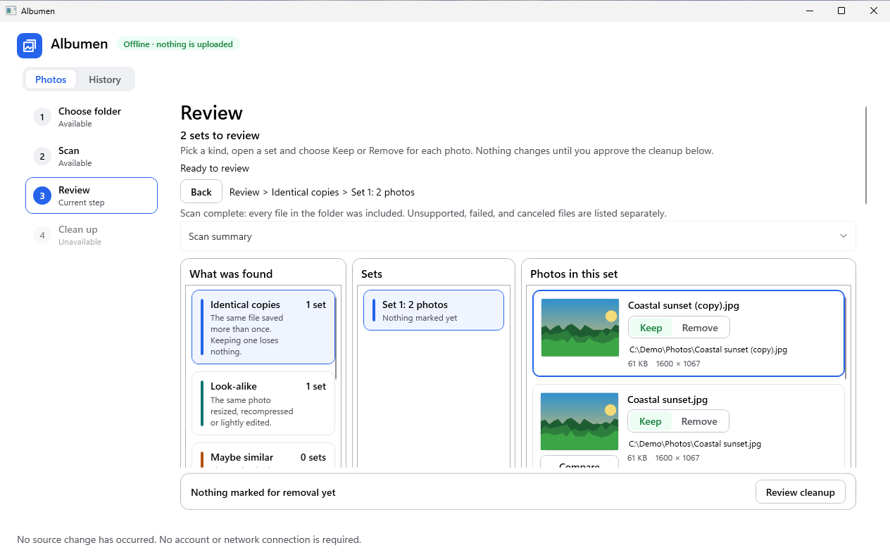
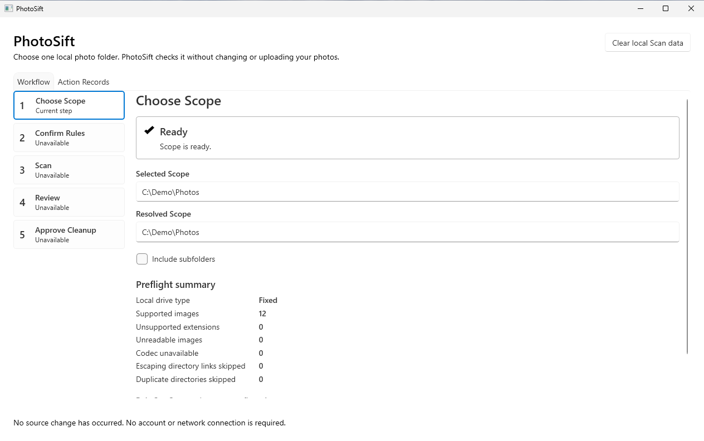
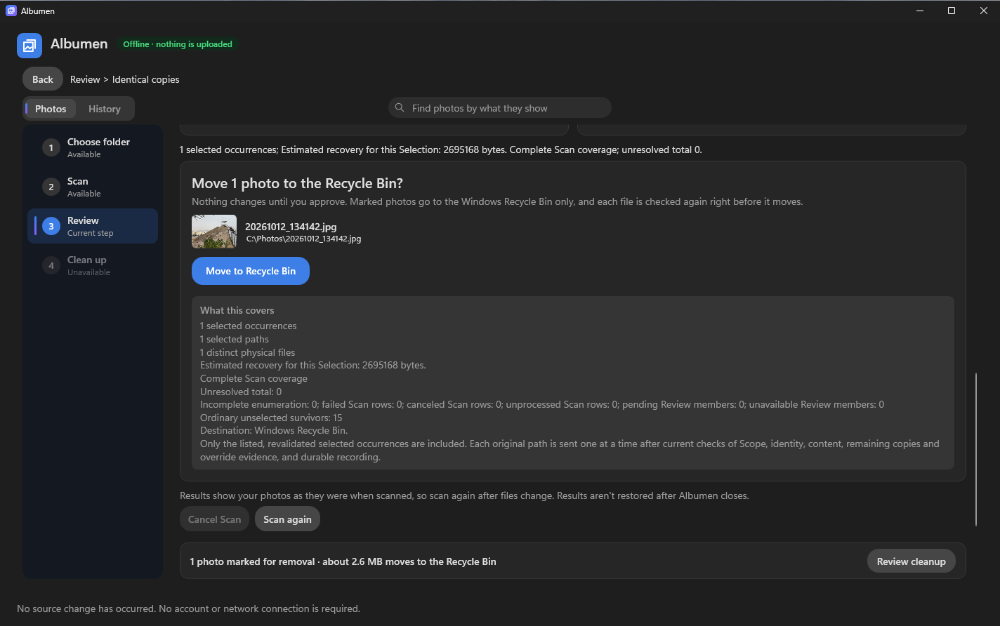
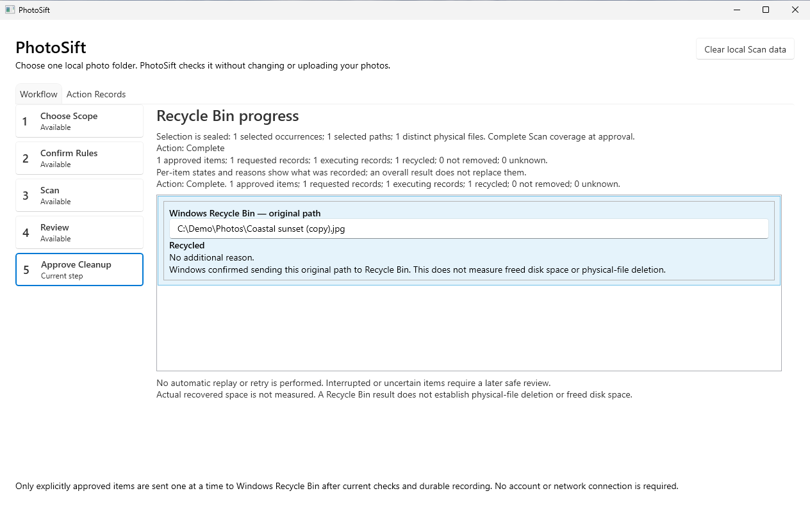
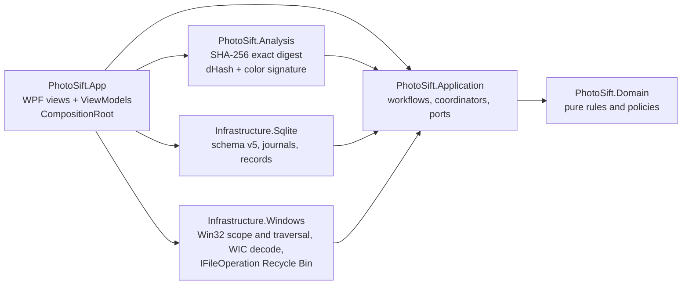

# PhotoSift

[](https://github.com/IgalFridman-dev/PhotoSift/actions/workflows/ci.yml)


**Find duplicate photos on Windows, review each group, and send only what you approve to the Recycle Bin.**



PhotoSift is a privacy-first desktop app for Windows 11 built with .NET 10, C# 14 and WPF. It scans one
local folder for byte-identical and conservatively near-identical JPEG/PNG images, groups them for
review, and moves only the files you explicitly approve to the Recycle Bin. It works fully offline,
never deletes permanently, and keeps a durable record of every action it takes.

| 1. Choose a folder | 2. Approve exactly what goes | 3. See every outcome |
|---|---|---|
|  |  |  |
| Preflight checks the folder is local and readable before any scan. | The approval lists every path, the estimated space recovered and the destination. | Each file is sent on its own and its result is recorded. |

## Why it is interesting

Deleting someone's photos is a one-way door, so PhotoSift is designed around one question:
*what has to be true before the app is allowed to touch a file?*

- **At least one survivor per group.** The review model refuses any selection that would remove every copy.
- **Sealed approval, fresh revalidation.** Approval produces an immutable request. Right before each
  Recycle Bin call the file is re-checked on disk; if it changed, the action is blocked.
- **Write-ahead journal.** Every action is recorded as `Requested → Executing` in SQLite *before* the
  shell call, and its outcome after. If the app crashes mid-action, the next launch reconciles the
  journal and reports the outcome as unknown. It never replays the action.
- **One item at a time, one owner.** A single serialized Action owner performs every Recycle Bin call,
  so there are no races between UI threads and file operations.
- **Offline by construction.** No network code, no telemetry, no accounts. Verified with network
  audits in an isolated VM that has no network adapter.

## Features

| | |
|---|---|
| **Exact duplicates** | Streaming SHA-256 over file bytes; hard links are recognized as aliases of the same file, not as copies. |
| **Near duplicates** | Managed dHash plus a color signature with conservative thresholds; borderline pairs are left ungrouped. |
| **Guided workflow** | Four steps (Choose folder → Scan → Review → Clean up), each unlocked only when the previous one is valid. The folder and the scan options share one screen. |
| **Safe scope** | Preflight rejects network shares, cloud-only placeholders and protected system folders before scanning. |
| **Review** | Exact and Near categories, virtualized groups, bounded previews, keyboard navigation and a suggested survivor you can override. |
| **History** | Every cleanup's per-photo outcome survives relaunch and can be checked again read-only later. |
| **Crash-safe scans** | Scan state is checkpointed in SQLite with reconciled accounting; an interrupted scan is closed safely and restarted fresh. |

## Architecture

A hexagonal modular monolith. Domain and Application never reference WPF, SQLite or Win32;
infrastructure adapters implement the ports Application declares, and only the composition root
wires them together. These boundaries are enforced by architecture tests, not just convention.



A walkthrough of one run from folder selection to Recycle Bin, with the classes involved, is in
**[docs/HOW-IT-WORKS.md](docs/HOW-IT-WORKS.md)**.

| Area | Technology |
|---|---|
| UI | WPF with the Fluent theme, MVVM, UI Automation for keyboard and screen reader support |
| Imaging | Windows Imaging Component (WIC) for orientation-aware decoding and bounded previews |
| File system | Win32 traversal and identity APIs, `IFileOperation` for Recycle Bin moves |
| Storage | SQLite (`Microsoft.Data.Sqlite`) with forward-only schema migrations and WAL |
| Tests | xUnit v3 (5 projects), script tests for the PowerShell tooling |
| Build | .NET SDK 10.0.400 pinned in `global.json`, central package versions, locked restore, warnings as errors |

## Quality and verification

- **About 21,500 lines of production C# and 37,000 lines of tests** across Domain, Application,
  Analysis, Infrastructure and real-window WPF scenario suites.
- **Full suite: 1,757 / 1,757 passing** in the official gate on the release candidate.
- **Isolated verification VM.** Official gates run in a Hyper-V VM with no network adapter, restored
  from a known checkpoint for every run. This proves the offline guarantee and keeps runs reproducible.
- **Reproducible release.** Two independent locked, self-contained publishes are compared file by
  file (path, length, SHA-256) before the ZIP is produced, with a checksum-verifying launcher and
  third-party notices for every bundled component.
- **CI.** Every pull request builds with warnings as errors and runs the test suites on `windows-latest`.
- **Evidence over claims.** Every finished story has a written verification record, and the V1
  release decision lists its open limitations instead of hiding them (see below).

## Getting started

**To run it** you need Windows 11 x64 and nothing else: the release is self-contained, so no .NET
install is required.

1. Download the ZIP from the latest release and extract it to a local folder.
2. Run `Start-PhotoSift.cmd`. It checks every packaged file against its manifest, then starts the app.
3. The build is not code-signed, so Windows SmartScreen may warn on first run: choose
   **More info → Run anyway**.

**To build it** you need the .NET SDK `10.0.400`:

```powershell
dotnet restore PhotoSift.slnx --locked-mode
dotnet build   PhotoSift.slnx -c Release --no-restore
dotnet run     --project src/PhotoSift.App -c Release
dotnet test    PhotoSift.slnx -c Release --no-build
```

Some Infrastructure and WPF scenario tests exercise real Windows APIs and expect an isolated machine;
the official gate scripts live in [`eng/verification/`](eng/verification/) and are described in
[`.claude/skills/verify-gates/SKILL.md`](.claude/skills/verify-gates/SKILL.md).

## Known limitations (V1)

- Accessibility work is not complete. The local-data warning now raises a screen-reader
  announcement, but that has not yet been checked with Narrator (PM-002, PM-005). PhotoSift makes
  no accessibility-compliance claim.
- HEIF support depends on the installed Windows codec and is best effort; JPEG and PNG are supported.
- Near-duplicate quality was validated on a small labeled corpus. Human review is always required.
- A first scan of 300 images took 12.1 s on a 2-CPU, 4 GiB VM. That is an observation, not a benchmark.

## Roadmap

- **V1.1:** blur detection as review evidence, and reuse of previously computed signatures across scans.
- **V1.2:** on-device semantic "likely matches" using a local image encoder, still fully offline.

Deferred work is tracked in [`docs/backlog/post-mvp.md`](docs/backlog/post-mvp.md).

## How it was built

PhotoSift is developed with AI coding agents under a written, reviewable process rather than
ad-hoc prompting. The workflow is checked into the repo, so anyone can see exactly how changes are made:

| Piece | What it does |
|---|---|
| [`CLAUDE.md`](CLAUDE.md) | Project guide: architecture boundaries, safety invariants, build and test rules every agent follows. |
| [`story-workflow`](.claude/skills/story-workflow/SKILL.md) skill | One story end to end: read the spec, design and plan, test-first build, review, verify, record evidence. |
| [`design-and-plan`](.claude/skills/design-and-plan/SKILL.md) skill | Turns a story spec into a design doc and a step-by-step plan before any code is written. |
| [`story-reviewer`](.claude/agents/story-reviewer.md) agent | Fresh-context reviewer that checks safety, boundaries, offline guarantees, spec fit and test honesty. |
| [`verify-gates`](.claude/skills/verify-gates/SKILL.md) skill | Runs the build, the test suites and the isolated VM gates, and records what actually passed. |
| [`commit-and-pr`](.claude/skills/commit-and-pr/SKILL.md) skill | Keeps commit messages and PR descriptions short, specific and honest about what was verified. |

Independent work runs in parallel: separate agents can implement a feature, review it with no shared
context, and drive CI, while every change still lands through a pull request that a human approves.
Product planning used the BMAD Method (brief → PRD → UX → architecture → 26 story specs).

## Repository layout

```text
src/            6 production projects: Domain, Application, Analysis,
                Infrastructure.Sqlite, Infrastructure.Windows, App
tests/          5 xUnit v3 projects + PowerShell tooling tests
eng/            Hyper-V verification gates and release packaging scripts
docs/           HOW-IT-WORKS and the deferred-work backlog
.github/        CI workflow
.claude/        skills, agents and commands used to develop PhotoSift
CLAUDE.md       guide for working on the code with Claude Code
```

Product planning, per-story specs and design docs, and the verification evidence records are kept in
a private development repository.

## License

Released under the [MIT License](LICENSE). Notices for the components shipped in the release package
are in [THIRD-PARTY-NOTICES.md](THIRD-PARTY-NOTICES.md).
