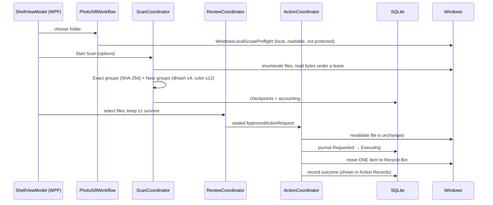

# How PhotoSift works

A one-page map of the app: what the user sees, how a click flows through the code, and where
data lives.

## What the user sees

One window (`src/PhotoSift.App/MainWindow.xaml`) with a left-hand list of five workflow phases.
Each phase unlocks only when the previous one is valid (`Domain/Workflow/WorkflowPhase.cs`).

| # | Phase | What happens on screen |
|---|---|---|
| 1 | **Choose Scope** | Pick one local folder, "Include subfolders" toggle. A preflight summary shows the resolved path, readable files and blocking reasons (network, cloud-only, protected folders). |
| 2 | **Confirm Rules** | Exact duplicates are always on; "Conservative Near duplicates" can be switched off. "Confirm Scan options". |
| 3 | **Scan** | Progress and live counts; "Cancel Scan". Outcome categories show what was grouped, skipped or unsupported. |
| 4 | **Review** | Categories (Exact / Near) → groups → side-by-side comparison with bounded previews. The user ticks files to remove; at least one survivor per group is enforced (a dialog asks for confirmation when the suggested survivor is overridden). |
| 5 | **Approve Cleanup** | A disclosure lists the exact original paths. "Approve Cleanup" moves them one by one to the Recycle Bin and shows progress. Below it, **Action Records** list every past outcome, survive relaunch, and can be revalidated read-only. |

## Code layers

Domain and Application never reference WPF, SQLite or Win32; Infrastructure implements the
ports Application declares; `Composition/CompositionRoot.cs` is the only place they meet.
Architecture tests in `tests/PhotoSift.Infrastructure.Tests/Architecture/` enforce this.

## One run, end to end

Key ideas:
- **Owner inboxes** (`ScanOwnerInbox`, `ReviewOwnerInbox`, `ActionOwnerInbox`): each area has
  one serialized owner, so UI threads never race on state; the UI renders immutable snapshots.
- **Fail closed**: anything uncertain (file changed, crash mid-action, unreadable local data)
  blocks the action and is shown as such; interrupted actions are reconciled on restart, never replayed.
- **Near duplicates are conservative**: thresholds live in `Application/Scan/NearDuplicateThresholds.cs`;
  borderline pairs are not grouped.

## Where data lives

- `%LOCALAPPDATA%\PhotoSift\photosift.db` — SQLite (scan identity, checkpoints, override
  evidence, action journal and records). "Clear local Scan data" removes scan data only.
- Photos are only read, never modified; removal = Windows Recycle Bin (restorable).
- No network access at all (verified by network audits in a VM with no network adapter).

## Tests at a glance

| Project | Covers |
|---|---|
| `PhotoSift.Domain.Tests` | pure policies (survivor, scope, transitions) |
| `PhotoSift.Application.Tests` | coordinators, workflows, fakes for ports |
| `PhotoSift.Analysis.Tests` | hashing and perceptual signatures |
| `PhotoSift.Infrastructure.Tests` | Win32/WIC/SQLite adapters + architecture rules |
| `PhotoSift.Scenarios.Tests` | real WPF window, keyboard and automation flows |
| `tests/tooling/*.Tests.ps1` | Pester tests for VM and release scripts |
