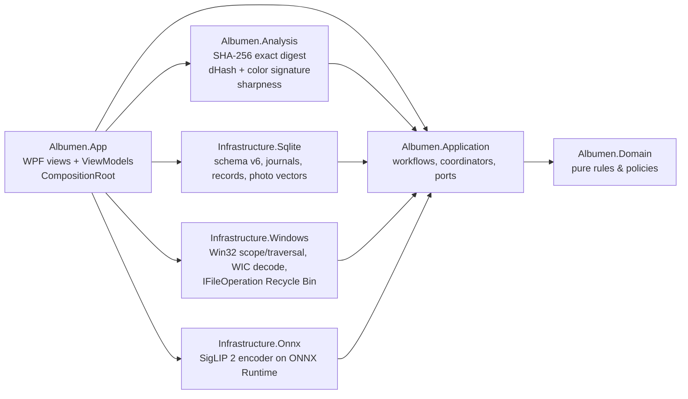
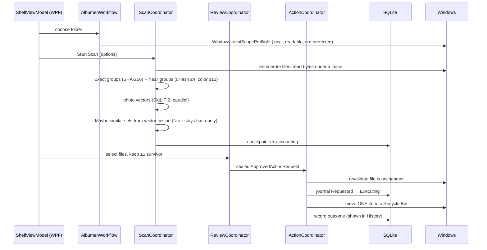

# How Albumen works

A one-page map of the app: what the user sees, how a click flows through the code, and where
data lives.

## What the user sees

One dark window (`src/Albumen.App/MainWindow.xaml`; colours in `Themes/AlbumenPalette.cs`, which
switches to system colours under High Contrast) with a left-hand list of steps. The workflow has five
phases (`Domain/Workflow/WorkflowPhase.cs`), each unlocked only when the previous one is valid; the
first two share one screen, so the list shows four steps.

| Step | Phase | What happens on screen |
|---|---|---|
| 1 | **Choose folder** (phases ChooseScope + ConfirmRules) | Pick one local folder and "Include subfolders"; identical copies and look-alikes are always found. A status strip says one sentence per state (ready with the photo count, checking, blocked, not checked) and the line under it names the first six photos the folder check found ("Includes IMG_0001.jpg, … and 12 more."), since the Windows folder picker lists folders only (its title says so). Blocking reasons (network, cloud-only, protected folders) appear under the strip, and the folder check counts, restrictions and the scan options' status wait under "Details". One "Scan N photos" button continues, confirms the options for this folder and starts the scan, each step checked by the workflow owner as before. |
| 2 | **Scan** | Progress and live counts; "Cancel Scan". A last stage indexes the photos for search (Cancel there skips only that stage). The finished summary counts photos in identical sets, in look-alike sets, unique photos, uncertain, unsupported, canceled/unprocessed and failed. |
| 3 | **Review** | Kinds shown as Identical copies / Look-alike / Maybe similar / Couldn't check (internally Exact / Near / Uncertain / CouldNotAnalyze) in a narrow column; opening a kind shows all of its sets as a photo gallery (`Review/JustifiedPanel.cs`: rows of equal height, each photo as wide as its shape needs; a photo counts as 4:3 until its thumbnail loads, so a set's rows re-flow once its thumbnails arrive). Hovering a photo shows its facts (name, path, size, dimensions, why it is in the set). Below the gallery a Left and a Right Viewer show photos large, with one zoom and shared panning: drag a photo in, or right-click it and choose "Place in Left Viewer" / "Place in Right Viewer" (a click places it only while the Left Viewer is empty); dropping one viewer's photo on the other swaps them, dropping it anywhere else empties that viewer, and the photo's tile reads "Left Viewer" or "Right Viewer". The user marks a photo by right-click → "Remove" or the viewer's "Remove this photo" button (red while marked; "Unmark for removal" and the button undo it), and the tile shows a Removed sign; at least one survivor per group is enforced (a dialog asks for confirmation before a set's last kept photo is marked). The search bar at the top centre (Photos tab, Review only) filters Review: each kind narrows to the sets with a matching photo ("3 of 14 sets"), shown whole and best match first, with the matches labelled; matching photos in no open set are listed under "Other matches" and open read-only. The search marks nothing and keeps every mark, the approval says how many marked photos it hides, and the clear button shows everything again. |
| 4 | **Clean up** (phase ApproveCleanup) | The Review page ends with "Move N photos to the Recycle Bin?": the first marked photos with thumbnails and paths, then the full accounting. "Move to Recycle Bin" sends them one at a time and shows a progress bar, a card per photo (moved, skipped and why, or unknown) and a summary when it ends. |

A **History** view in the top bar lists every saved cleanup (one card each, with every photo's
outcome); records survive relaunch and unknown outcomes can be checked again read-only. "Clear scan
data" lives there too.

## Code layers

Domain and Application never reference WPF, SQLite or Win32; Infrastructure implements the
ports Application declares; `Composition/CompositionRoot.cs` is the only place they meet.
Architecture tests in `tests/Albumen.Infrastructure.Tests/Architecture/` enforce this.

## One run, end to end

Key ideas:
- **Owner inboxes** (`ScanOwnerInbox`, `ReviewOwnerInbox`, `ActionOwnerInbox`): each area has
  one serialized owner, so UI threads never race on state; the UI renders immutable snapshots.
- **Fail closed**: anything uncertain (file changed, crash mid-action, unreadable local data)
  blocks the action and is shown as such; interrupted actions are reconciled on restart, never replayed.
- **Near duplicates are conservative**: thresholds live in `Application/Scan/NearDuplicateThresholds.cs`;
  borderline pairs are not grouped.
- **The photo model only adds Maybe similar**: two photos the hash does not relate are Maybe similar
  when their vectors' cosine reaches `Application/Scan/MaybeSimilarThresholds.cs` (provisional until
  the labelled corpus sets it). Look-alike sets are built from the hash alone, so they are the same
  with or without the model; nothing the model finds is pre-marked.

## Where data lives

- `%LOCALAPPDATA%\Albumen\albumen.db` — SQLite (scan identity, checkpoints, override
  evidence, action journal and records, and the last Scan's photo vectors). "Clear scan data" (in History) removes scan data only.
- `models\` next to `Albumen.App.exe` — the SigLIP 2 files (`vision.onnx`, `text.onnx`,
  `tokenizer.model`, 1,112 MB) and `manifest.json` with each file's length and SHA-256. A missing or
  changed file makes only the semantic features unavailable; Exact, Look-alike, Review and cleanup
  work without them.
- Photos are only read, never modified; removal = Windows Recycle Bin (restorable).
- No network access at all (verified by network audits in a VM with no network adapter).

## What the model costs

Measured in the verification VM (2 CPU, 4 GiB, no network); raw numbers, not targets:
indexing 73.5 ms per photo with 4 workers and a 566 MB peak working set; one text search over
10,000 stored vectors 70 ms. The release ZIP is about 1.1 GB, almost all of it model.
The full measurements are in the verification records of the development repository.

## Tests at a glance

| Project | Covers |
|---|---|
| `Albumen.Domain.Tests` | pure policies (survivor, scope, transitions) |
| `Albumen.Application.Tests` | coordinators, workflows, fakes for ports |
| `Albumen.Analysis.Tests` | hashing, perceptual signatures and sharpness |
| `Albumen.Infrastructure.Tests` | Win32/WIC/SQLite/ONNX adapters + architecture rules |
| `Albumen.Scenarios.Tests` | real WPF window, keyboard and automation flows |
| `tests/tooling/*.Tests.ps1` | PowerShell tests for VM and release scripts |
