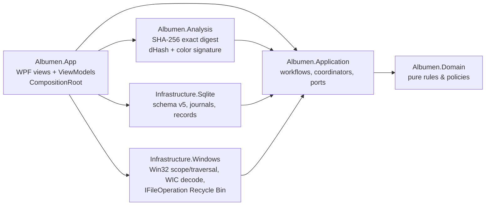
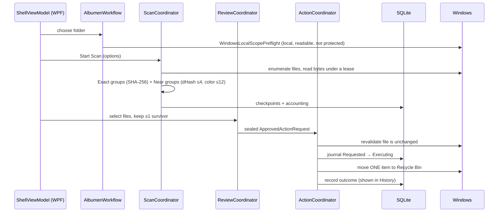

# How Albumen works

A one-page map of the app: what the user sees, how a click flows through the code, and where
data lives.

## What the user sees

One window (`src/Albumen.App/MainWindow.xaml`) with a left-hand list of steps. The workflow has five
phases (`Domain/Workflow/WorkflowPhase.cs`), each unlocked only when the previous one is valid; the
first two share one screen, so the list shows four steps.

| Step | Phase | What happens on screen |
|---|---|---|
| 1 | **Choose folder** (phases ChooseScope + ConfirmRules) | Pick one local folder, "Include subfolders", and "Look-alikes" (identical copies are always found, as the caption says). A status strip says one sentence per state (ready with the photo count, checking, blocked, not checked); blocking reasons (network, cloud-only, protected folders) appear under it, and the folder check counts, restrictions and the scan options' status wait under "Details". One "Scan N photos" button continues, confirms the options for this folder and starts the scan, each step checked by the workflow owner as before. |
| 2 | **Scan** | Progress and live counts; "Cancel Scan". Outcome categories show what was grouped, skipped or unsupported. |
| 3 | **Review** | Kinds shown as Identical copies / Look-alike / Maybe similar / Couldn't check (internally Exact / Near / Uncertain / CouldNotAnalyze) → sets → photos with bounded previews and side-by-side compare. The user switches photos to Remove; at least one survivor per group is enforced (a dialog asks for confirmation when the suggested survivor is overridden). |
| 4 | **Clean up** (phase ApproveCleanup) | The Review page ends with "Move N photos to the Recycle Bin?": the first marked photos with thumbnails and paths, then the full accounting. "Move to Recycle Bin" sends them one at a time and shows a progress bar, a card per photo (moved, skipped and why, or unknown) and a summary when it ends. |

A **History** view in the top bar lists every saved cleanup (one card each, with every photo's
outcome); records survive relaunch and unknown outcomes can be checked again read-only. "Clear scan
data" lives there too.

## Code layers

Domain and Application never reference WPF, SQLite or Win32; Infrastructure implements the
ports Application declares; `Composition/CompositionRoot.cs` is the only place they meet.
Architecture tests in `tests/Albumen.Infrastructure.Tests/Architecture/` enforce this.

## One run, end to end

Key ideas:
- **Owner inboxes** (`ScanOwnerInbox`, `ReviewOwnerInbox`, `ActionOwnerInbox`): each area has
  one serialized owner, so UI threads never race on state; the UI renders immutable snapshots.
- **Fail closed**: anything uncertain (file changed, crash mid-action, unreadable local data)
  blocks the action and is shown as such; interrupted actions are reconciled on restart, never replayed.
- **Near duplicates are conservative**: thresholds live in `Application/Scan/NearDuplicateThresholds.cs`;
  borderline pairs are not grouped.

## Where data lives

- `%LOCALAPPDATA%\Albumen\albumen.db` — SQLite (scan identity, checkpoints, override
  evidence, action journal and records). "Clear scan data" (in History) removes scan data only.
- Photos are only read, never modified; removal = Windows Recycle Bin (restorable).
- No network access at all (verified by network audits in a VM with no network adapter).

## Tests at a glance

| Project | Covers |
|---|---|
| `Albumen.Domain.Tests` | pure policies (survivor, scope, transitions) |
| `Albumen.Application.Tests` | coordinators, workflows, fakes for ports |
| `Albumen.Analysis.Tests` | hashing and perceptual signatures |
| `Albumen.Infrastructure.Tests` | Win32/WIC/SQLite adapters + architecture rules |
| `Albumen.Scenarios.Tests` | real WPF window, keyboard and automation flows |
| `tests/tooling/*.Tests.ps1` | PowerShell tests for VM and release scripts |
